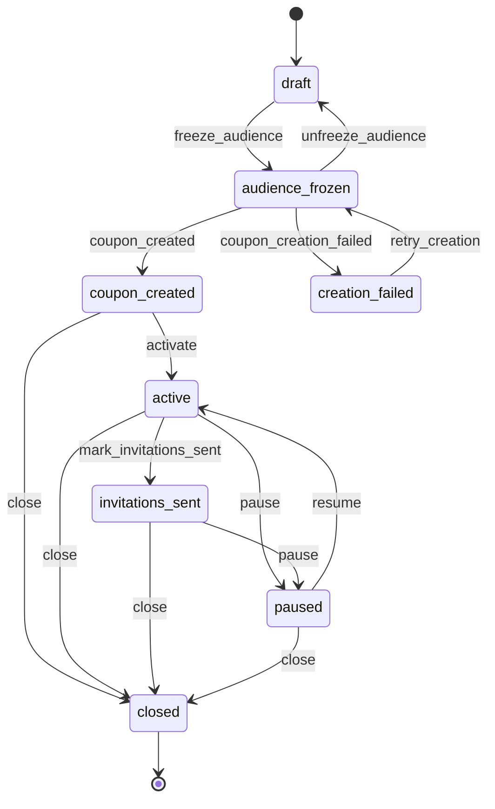

# Estados da campanha

Implementação: `src/domain/campaign/campaign-status.ts`. Rótulos em pt-BR: `src/copy/pt-BR.ts`.

| Estado             | Rótulo na interface      | Efeito na CW                                                    |
| ------------------ | ------------------------ | --------------------------------------------------------------- |
| `draft`            | Rascunho                 | nenhum                                                          |
| `audience_frozen`  | Rascunho                 | nenhum                                                          |
| `creation_failed`  | Rascunho, criação falhou | talvez; conferir pelo código antes de repetir                   |
| `coupon_created`   | Cupom criado, desativado | cupom existe com `active: false`                                |
| `active`           | Ativa, convite pendente  | cupom ativo                                                     |
| `invitations_sent` | Ativa, convites enviados | cupom ativo; gestor marcou o envio (sem confirmação de entrega) |
| `paused`           | Pausada por você         | cupom desativado                                                |
| `closed`           | Encerrada                | cupom desativado ou expirado                                    |

## Regras

- Cada transição grava uma linha em `campaign_events` com estado de origem, destino e quem fez.
- O público só pode ser congelado uma vez por tentativa de criação; descongelar volta ao rascunho.
- Ativar reenvia o `coupon_input` completo com `active: true` (a CW exige corpo completo no `PUT`).
- "Convites enviados" é uma declaração do gestor. Nunca escreva "enviada" ou "entregue" na interface.
