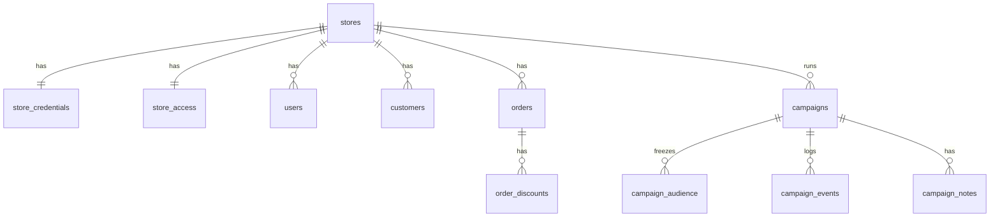

# Modelo de dados

Esquema em `supabase/migrations/20261118000000_initial_schema.sql`. Todas as tabelas têm RLS ativado e nenhuma política pública: só o servidor acessa.

| Tabela              | Por que existe                                                         |
| ------------------- | ---------------------------------------------------------------------- |
| `stores`            | Uma linha por instalação (unidade). `external_id` = `company_id` da CW |
| `store_credentials` | Tokens cifrados e trava de renovação (`refreshing_since`)              |
| `store_access`      | Último estado de acesso vindo da cobrança da CW                        |
| `users`             | Pessoas da loja que entram pelo SSO                                    |
| `customers`         | Só nome, telefone e autorização de WhatsApp (minimização LGPD)         |
| `orders`            | Pedidos sincronizados, com `outcome` normalizado e status bruto da CW  |
| `order_discounts`   | Descontos por pedido; `coupon_external_id` liga o pedido à campanha    |
| `campaigns`         | Estado, critério, oferta e o `coupon_input` exato enviado à CW         |
| `campaign_audience` | Público congelado: o denominador de "quem voltou"                      |
| `campaign_events`   | Trilha de auditoria de cada transição e efeito externo                 |
| `campaign_notes`    | Aprendizado registrado ao fim da campanha                              |
| `webhook_events`    | Caixa de entrada deduplicada por `(source, event_id)`                  |
| `sync_jobs`         | Fila de chamadas à CW com `run_after` para respeitar os limites        |

## Convenções

- Nomes em inglês, `snake_case`, tabelas no plural.
- IDs internos em `uuid`; IDs da CW em colunas `*_external_id` (`bigint`).
- Datas em `timestamptz`; a interface exibe em `America/Fortaleza` ou no fuso da loja.
- Valores em reais em `numeric(12, 2)`.
- Cada mudança de esquema é uma nova migração; nunca edite uma migração já aplicada.
