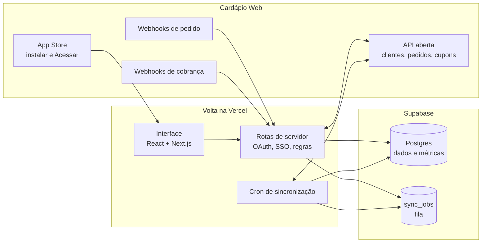

# Arquitetura

Um único app Next.js na Vercel, com o Supabase como banco e fila. Menos peças para operar e entregar no prazo do hackathon. Decisão registrada no [ADR 0001](../adr/0001-nextjs-supabase-single-app.md).

## Camadas do código

| Camada            | Pasta                           | Pode depender de   | Não pode depender de      |
| ----------------- | ------------------------------- | ------------------ | ------------------------- |
| Domínio           | `src/domain`                    | só de si mesma     | Next, React, Supabase, CW |
| Aplicação         | `src/application`               | domínio, portas    | adaptadores concretos     |
| Integrações       | `src/integrations/cardapio-web` | domínio (tipos)    | `app`, `server/database`  |
| Servidor          | `src/server`                    | aplicação, domínio | `app`                     |
| Interface e rotas | `src/app`, `src/components`     | todas              | —                         |

A regra do domínio é verificada pelo ESLint (`no-restricted-imports` em `src/domain/**`).

## Fluxos principais

1. **Instalação:** App Store → `/api/cw/oauth/start` (PKCE) → portal da CW → `/api/cw/oauth/callback` → troca do código no servidor → `identity/context` → conta criada sem formulário → backfill do histórico enfileirado.
2. **Acesso diário:** botão Acessar → `/api/cw/sso?ticket=...` → validação do ticket no servidor → sessão.
3. **Campanha:** público congelado → oferta validada → `POST coupons` com `active: false` → revisão → `PUT coupons/{id}` com `active: true` → gestor convida → marca envio.
4. **Acompanhamento:** webhook de pedido → `webhook_events` (deduplicado por `event_id`) → `sync_jobs` → cron busca detalhes → `orders` e `order_discounts` → métricas.
5. **Acesso pago:** webhook `MARKETPLACE_APP_ACCESS_UPDATED` → `store_access` → verificado no servidor a cada chamada protegida.

## Agendamento

`/api/cron/sync` roda a cada minuto (Vercel Cron, ou `pg_cron` + `pg_net` no Supabase), protegido por `CRON_SECRET`. Cada execução pega poucas tarefas por loja com `FOR UPDATE SKIP LOCKED`, respeitando 5 consultas por minuto ao histórico. Uma conciliação diária repassa o histórico do dia anterior, porque a CW descarta avisos de pedido depois das retentativas.

## Por que não usar IA

As regras (soma, status, limites, público) são determinísticas e mais fáceis de testar e explicar à banca. Ver [ADR 0003](../adr/0003-deterministic-rules-no-ai.md).
